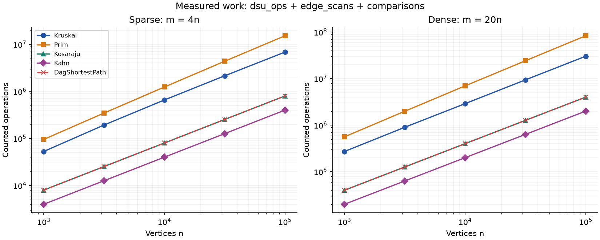
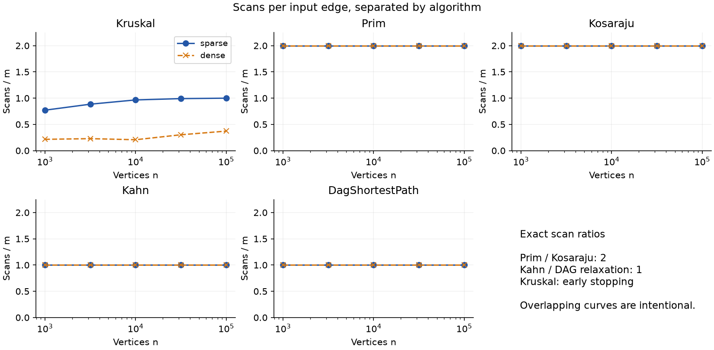
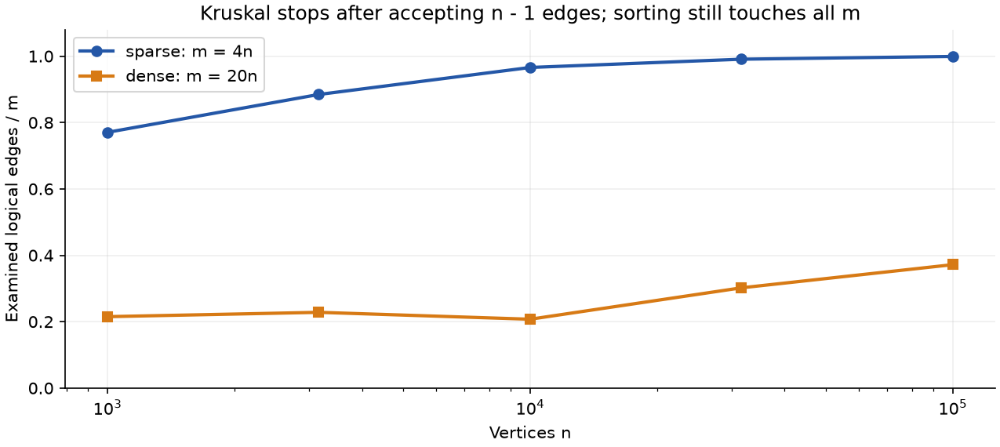

# DAA Assignment 3: City Network & Job Scheduler

**Implementation:** Java 21, Gradle 9.1.0, JUnit 5.13.4.
**Repository:** https://github.com/saloverni/daa-assignment-3 · `main`, release `v1.0`.
**Evidence:** [CSV](results/results.csv), [generated analysis](results/analysis.md),
[runtime record](results/environment.txt). Reproduce with `./gradlew reproduce`.

## 1. Representation and complexity

One adjacency-list multigraph serves every algorithm. Vertices are integers;
weights are `int`, while path distances and forest totals are `long`. A logical
undirected edge has two adjacency entries, including a self-loop. Parallel edges
are retained. Indegrees are maintained during insertion. The four input files
exercise connected, disconnected, cyclic and negative-weight acyclic cases.
MST algorithms return a forest and component count; Kahn rejects cycles explicitly.

Let V be vertices, E logical input edges, and C connected components. Space below
is additional to the input graph and includes working storage and returned output.
Empty and isolated vertices still incur initialization work.

| Operation | Time | Extra space | Justification |
|---|---|---|---|
| DSU makeSet | O(V) | O(V) | Initialize one parent and size per element. |
| DSU find / union | O(α(V)) amortized | O(1) per call; O(V) retained | Union by size bounds tree height; compression shortens subsequent paths. |
| Kruskal | O(V + E log(E+1) + E α(V)) | O(V+E) | Sort a copied edge list, perform at most E unions, retain V−C edges. |
| Prim, lazy heap | O(V + E log(E+1)) | O(V+E) | Scan both adjacency orientations; insert and remove at most E candidate edges. |
| Kosaraju | O(V+E) | O(V+E) | Two DFS passes, explicit O(V) stacks and a reversed graph. |
| Kahn | O(V+E) | O(V) | Copy cached indegrees, queue each vertex once, process each outgoing edge once. |
| DAG shortest paths | O(V+E) | O(V) | Kahn preparation and one relaxation pass; distance, parent and order arrays. |

For a simple connected graph the MST bounds are commonly written O(E log V).
This implementation allows arbitrarily many parallel edges, so the lazy Prim
heap can contain O(E) entries and log E is the precise bound. Union by size alone
gives logarithmic height: each time a node's depth increases, its set at least
doubles. With path compression the standard amortized bound becomes inverse
Ackermann. A single operation is not guaranteed constant time, and counting API
calls does not empirically prove the α(V) theorem.

The benchmark contains 10 size/density combinations, each with three graph kinds;
there are 50 algorithm rows, with DSU measured inside Kruskal. “Dense” here means
20V edges, not an asymptotically dense Θ(V²) graph. Every graph begins with a fresh
`Random(42)` and the specified shuffle, endpoint draws and weights in 1..1000.
All ten reference triples match exactly; for 100,000 / 2,000,000, the MST weight is
3,056,681, SCC count is 1 and sum of DAG distances is 23,512,087.

## 2. Correctness and validation

### Cut property: why both MST algorithms are safe

Let F be a forest contained in some minimum spanning forest, and choose a cut
that no edge of F crosses. Let e be a minimum-weight edge crossing that cut
inside a connected component. If an optimal forest T already contains e, adding
it is safe. Otherwise, adding e to T creates a cycle, and the path between its
endpoints includes another crossing edge f. Removing f restores a spanning
forest with weight no greater than T because w(e) ≤ w(f), and f cannot belong
to F since F respects the cut. Kruskal processes edges in nondecreasing order
and accepts an edge only between different DSU components, so it is a lightest
available edge across a component cut. Prim chooses the lightest queued edge
from its visited set to an unvisited vertex and skips stale entries, so the same
argument applies at every step and after every restart in a disconnected graph.

### Induction on the topological order

Connect a virtual super-source to every zero-indegree vertex with a zero-weight
edge, which is equivalent to initializing those distances to zero. Every vertex
of a finite DAG is reachable from at least one such source, because repeatedly
following predecessors must terminate without a cycle. As the base case, a
zero-indegree vertex has no incoming graph path that could improve its initial
zero distance. Assume that all vertices before v in a topological order already
have their optimal distances. Every edge into v comes from an earlier vertex,
so every possible final edge of a path to v has already been relaxed and the
minimum candidate is exactly its shortest distance. Relaxing v's outgoing edges
therefore preserves the induction invariant, while each successful improvement
records a predecessor that reconstructs a real optimal path. Negative weights
do not affect this argument because no predecessor can occur later and no cycle
can repeatedly reduce a path; general graphs need other algorithms such as
Bellman–Ford, and reachable negative cycles can make a finite optimum undefined.

### Validation evidence

The 17 JUnit test methods include 100 connected random MST comparisons, with
exactly V−1 edges and independent acyclicity checks; 25 tiny cases additionally
use exhaustive spanning-tree enumeration. Random DSU operations are compared
with an explicit relabeling partition. SCC labels are compared pairwise with
BFS reachability in the original and reversed graphs on 50 random cases up to
200 vertices. Another test visits a path of 100,000 vertices, recording explicit
stack depth 100,000 without recursive calls. One hundred randomly permuted DAGs
with negative weights are compared with Bellman–Ford; reconstructed paths are
checked edge by edge. Fixtures test self-loops, parallel edges, disconnected
components, cycles, isolated and empty graphs, and totals above the `int` range.
The full benchmark separately checks all reference values and every returned
topological order, including at the largest size.

## 3. Counters against formulas and fitted slopes

Counters are incremented inside algorithm operations. `dsu_ops` counts finds
plus successful unions; `comparisons` counts weight/distance comparisons.
`edge_scans` excludes sorting, graph reversal and validation; Kosaraju therefore
records its two DFS passes only. DAG counters cover relaxation, while its timing
also includes Kahn preparation. `max_depth` measures active explicit DFS frames,
not an operation count. Full definitions are in the README.

The following table is measured from all ten workloads. K and P mean Kruskal and
Prim, S means Kosaraju, T means Kahn, D means DAG relaxation, and Q is comparisons.
The final two columns use edge scans as their numerator.

| V | E/V | K: Q/(E log₂ E) | K: DSU/E | P: Q/(E log₂ E) | S/(V+E) | T,D/(V+E) |
|---:|---:|---:|---:|---:|---:|---:|
| 1,000 | 4 | .8914 | 1.7908 | 1.8291 | 1.6000 | .8000 |
| 1,000 | 20 | .9027 | .4802 | 1.8248 | 1.9048 | .9524 |
| 3,162 | 4 | .9069 | 2.0191 | 1.8654 | 1.6000 | .8000 |
| 3,162 | 20 | .8464 | .5063 | 1.8468 | 1.9048 | .9524 |
| 10,000 | 4 | .8692 | 2.1818 | 1.8952 | 1.6000 | .8000 |
| 10,000 | 20 | .7839 | .4647 | 1.8657 | 1.9048 | .9524 |
| 31,623 | 4 | .8091 | 2.2317 | 1.9210 | 1.6000 | .8000 |
| 31,623 | 20 | .7200 | .6540 | 1.8779 | 1.9048 | .9524 |
| 100,000 | 4 | .7447 | 2.2483 | 1.9344 | 1.6000 | .8000 |
| 100,000 | 20 | .6662 | .7936 | 1.8896 | 1.9048 | .9524 |

Traversal ratios are exactly constant at each density; Prim's comparison ratio
varies modestly. Kruskal's ratios are bounded but not constant: early stopping
changes DSU/E, and repeated weights plus sorting behavior affect comparisons.
If s sorted edges are examined on these connected graphs, DSU operations are
exactly 2s + V−1, so DSU/(2s+V−1) is 1 throughout. These call counts validate the
instrumentation, not the internal amortized cost of find. Bounded finite-sample
ratios support the theoretical bounds; they do not prove an asymptotic class.

Slopes below are ordinary least-squares fits of ln(counter) against ln(V) over
five sizes, separately for each density. Since E=cV, fitting against E gives
the same slope. Total work is scans + comparisons + DSU operations.

| Algorithm | Scan slope, sparse / dense | Total-work slope, sparse / dense |
|---|---:|---:|
| Kruskal | 1.0550 / 1.1194 | 1.0537 / 1.0219 |
| Prim | 1.0000 / 1.0000 | 1.1007 / 1.0850 |
| Kosaraju | 1.0000 / 1.0000 | 1.0000 / 1.0000 |
| Kahn | 1.0000 / 1.0000 | 1.0000 / 1.0000 |
| DAG relaxation | 1.0000 / 1.0000 | 1.0000 / 1.0000 |

**Interpretation of the assignment's slope wording:** Kruskal scans at most E
edges, so its scan slope does not measure the E log E sorting term. Its observed
scan slope exceeds one because the examined fraction generally increases with
size. Sorting-comparison slopes are 1.0545 / 1.0159; the 1,000-value weight range
and finite samples must be considered. Neither finite-range slope contradicts
the worst-case sorting bound. Prim's scans are also linear despite heap work.

## 4. Operation plots

**Figure 1.** Each algorithm has a line for each density, split into two panels.
Traversal counts grow linearly. Heap and sorting comparisons dominate the MST
work proxy. Kosaraju and DAG relaxation overlap because each contributes 2E
counted operations: two scans per edge versus one scan and one comparison.
These units are not equal-cost CPU instructions; no vertex initialization is
counted, so the proxy alone cannot describe an edgeless graph.

**Figure 2.** Prim and Kosaraju have exact scan ratios of two, while Kahn and DAG
relaxation have ratios of one, at all sizes and both densities. Prim scans both
orientations of each undirected edge. Kruskal is the only variable curve because
it stops when the accepted forest becomes connected; disconnected inputs exhaust
the sorted list. Flat curves confirm linear edge processing, while the separate
comparison counter captures the additional MST work.

## 5. Algorithm choice and practical interpretation

**Figure 3.** At V=100,000 Kruskal examines 99.92% of the sparse edges but only
37.18% of the denser edges. At V=1,000 those fractions are 77.05% and 21.51%.
Early stopping saves DSU work, especially on the denser inputs, but sorting still
processes the whole edge list. At the largest dense point Kruskal performs
27,890,128 comparisons, compared with Prim's 79,103,986 heap comparisons. This
supports choosing Kruskal for this workload and implementation, not claiming
that every Kruskal implementation universally beats every Prim implementation.

| Situation | Choice | Reason |
|---|---|---|
| Repeated undirected connectivity queries | DSU | Almost-constant amortized updates; no path search needed. |
| Sparse undirected edge list, possibly disconnected | Kruskal | Natural sorted-edge processing; automatically returns a forest. |
| Sparse adjacency lists, grow from one starting district | Heap Prim | Uses local outgoing edges directly; restart for disconnected parts. |
| Truly dense simple graph with a matrix | O(V²) matrix Prim (not implemented) | Avoids a heap and sorting Θ(V²) edges. |
| This assignment's 20V multigraphs | Kruskal | Fewer comparisons and smaller examined fraction in the measured data. |
| Directed graph may contain cycles; identify deadlocks | Kosaraju | SCCs isolate mutually reachable jobs; singleton self-loops also matter. |
| Need job order and cycle detection | Kahn | Produces a valid order or explicitly reports a cycle. |
| Weighted DAG, including negative weights | DAG shortest paths | Topological relaxation is O(V+E); no priority queue needed. |
| General directed graph with negative edges | Bellman–Ford (test oracle) | Allows negative edges and can detect reachable negative cycles. |

The median of five measured runs at the largest dense point was approximately
430 ms for Kruskal, 1,637 ms for Prim, 612 ms for Kosaraju, 90 ms for Kahn and
134 ms for DAG shortest paths on the recorded Java 21 Linux environment. These
figures include algorithm allocations, graph reversal for SCC, and topological
preparation for DAG paths; they exclude input generation and result validation.
Small-input times are noisy and can even decrease at a larger input after JVM
compilation. Different processors, JVMs, garbage collection and background work
change these times; reproducible operation counts are the main evidence.